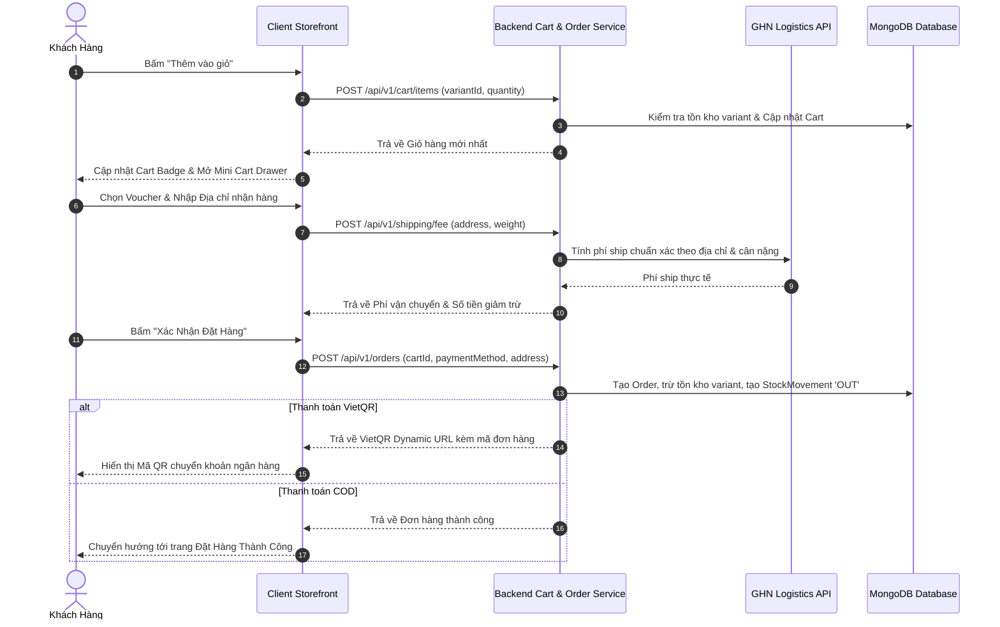
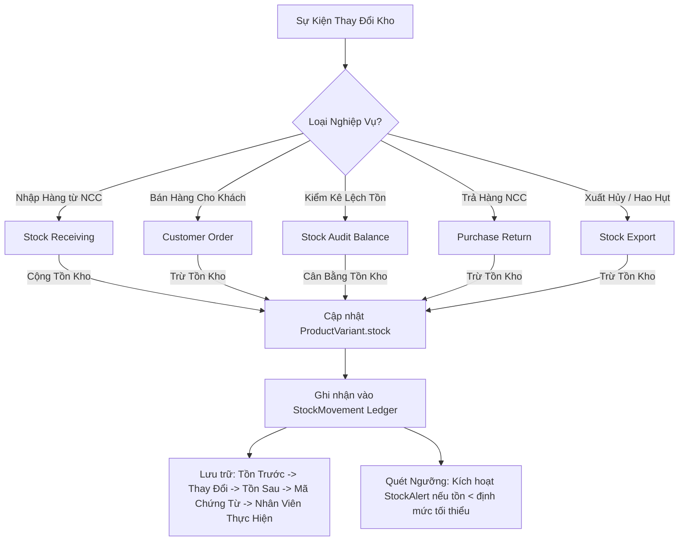
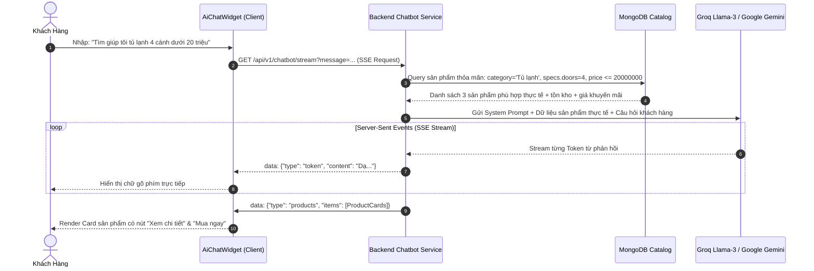

# context.md — Tài Liệu Kiến Trúc Codebase & Chuẩn Chia File Toàn Hệ Thống

> **Dự án**: Sàn TMĐT Clone Haravan (E-Commerce Enterprise Platform)  
> **Phiên bản tài liệu**: 2.0 (Toàn diện cho cả Backend, Admin Panel và Client Storefront)  
> **Mục đích**: Làm kim chỉ nam kiến trúc, hướng dẫn chia file, phân lớp trách nhiệm (Separation of Concerns), luồng dữ liệu và quy chuẩn code cho toàn bộ lập trình viên.

> **Đính chính (2026-10-16)**: Một số mục dưới đây được viết từ sớm. Stack thật theo package.json: BE Express 5 + Mongoose 9 + Zod 4 (không Joi, không Helmet, không rate-limit package, chưa có Redis); Admin React 19 + Vite 8 + React Router 7 + Tailwind 4; Client Next 16 + React 19 + Tailwind 4. DB là MongoDB Atlas (remote). Tóm tắt bối cảnh và quyết định mới nhất nằm ở `AGENTS.md` (mục 5) và `docs/progress.md`.

---

## 📑 Mục Lục

1. [Tổng Quan Kiến Trúc Monorepo & Cổng Mạng](#1-tổng-quan-kiến-trúc-monorepo--cổng-mạng)
2. [Kiến Trúc & Chuẩn Chia File Backend (`BE`)](#2-kiến-trúc--chuẩn-chia-file-backend-be)
   - [2.1 Tech Stack Backend](#21-tech-stack-backend)
   - [2.2 Cấu trúc Thư mục Backend Chi tiết](#22-cấu-trúc-thư-mục-backend-chi-tiết)
   - [2.3 Quy chuẩn Phân Lớp Trách Nhiệm (MVC + Service Layer)](#23-quy-chuẩn-phân-lớp-trách-nhiệm-mvc--service-layer)
   - [2.4 Chuẩn Request / Response & Xử Lý Lỗi Tập Trung](#24-chuẩn-request--response--xử-lý-lỗi-tập-trung)
   - [2.5 Quy ước Đặt Tên Backend (Naming Conventions)](#25-quy-ước-đặt-tên-backend-naming-conventions)
   - [2.6 Luồng Xác Thực & Quản Lý Phiên (Auth & Session Flow)](#26-luồng-xác-thực--quản-lý-phiên-auth--session-flow)
   - [2.7 Động cơ AI Chatbot RAG & Dịch vụ Python ML](#27-động-cơ-ai-chatbot-rag--dịch-vụ-python-ml)
3. [Kiến Trúc & Chuẩn Chia File Admin Panel (`Admin`)](#3-kiến-trúc--chuẩn-chia-file-admin-panel-admin)
   - [3.1 Tech Stack Admin](#31-tech-stack-admin)
   - [3.2 Cấu trúc Thư mục Admin Chi tiết](#32-cấu-trúc-thư-mục-admin-chi-tiết)
   - [3.3 Hệ Thống Routing & Phân Quyền Bảo Vệ (`ProtectedRoute`)](#33-hệ-thống-routing--phân-quyền-bảo-vệ-protectedroute)
   - [3.4 Quản Lý Trạng Thái (State Management Pattern)](#34-quản-lý-trạng-thái-state-management-pattern)
   - [3.5 Axios Client & Cơ Chế Auto Refresh Token](#35-axios-client--cơ-chế-auto-refresh-token)
   - [3.6 Chuẩn Thiết Kế UI/UX Admin (Design Directives)](#36-chuẩn-thiết-kế-uiux-admin-design-directives)
4. [Kiến Trúc & Chuẩn Chia File Client Storefront (`client`)](#4-kiến-trúc--chuẩn-chia-file-client-storefront-client)
   - [4.1 Tech Stack Client](#41-tech-stack-client)
   - [4.2 Cấu trúc Thư mục Client App Router Chi tiết](#42-cấu-trúc-thư-mục-client-app-router-chi-tiết)
   - [4.3 Chiến lược Server Components (RSC) & Client Components](#43-chiến-lược-server-components-rsc--client-components)
   - [4.4 Phân Tầng Dịch Vụ Gọi API (Server Services vs Client Services)](#44-phân-tầng-dịch-vụ-gọi-api-server-services-vs-client-services)
   - [4.5 Quản Lý Trạng Thái Giỏ Hàng & Người Dùng với Zustand Persist](#45-quản-lý-trạng-thái-giỏ-hàng--người-dùng-với-zustand-persist)
   - [4.6 Tổ Chức Component Theo Miền Nghiệp Vụ (Domain-driven Components)](#46-tổ-chức-component-theo-miền-nghiệp-vụ-domain-driven-components)
5. [Sơ Đồ Các Luồng Nghiệp Vụ Trọng Tâm (Core Workflows)](#5-sơ-đồ-các-luồng-nghiệp-vụ-trọng-tâm-core-workflows)
   - [5.1 Luồng Giỏ Hàng & Đặt Hàng (Cart & Checkout)](#51-luồng-giỏ-hàng--đặt-hàng-cart--checkout)
   - [5.2 Luồng Quản Lý Sổ Kho & Biến Động (Stock Movement Flow)](#52-luồng-quản-lý-sổ-kho--biến-động-stock-movement-flow)
   - [5.3 Luồng Trợ Lý AI Chatbot RAG SSE Streaming](#53-luồng-trợ-lý-ai-chatbot-rag-sse-streaming)
   - [5.4 Luồng Gợi Ý Cá Nhân Hóa (Recommendation Pipeline)](#54-luồng-gợi-ý-cá-nhân-hóa-recommendation-pipeline)

---

## 1. Tổng Quan Kiến Trúc Monorepo & Cổng Mạng

Hệ thống được tổ chức dạng đa phân hệ độc lập (Multi-package Monorepo Structure):

```
cloneharavan/
├── BE/               — Backend API REST + AI Engine (Node.js + Express + MongoDB) -> Port: 5000
│   └── python-services/ — Python ML Scripts & CSV Recommendation Datasets
├── Admin/            — Dashboard Quản trị Doanh nghiệp (React + Vite + Tailwind)   -> Port: 5173
├── client/           — Storefront Bán hàng Khách hàng (Next.js 16 App Router)       -> Port: 3000
└── docs/             — Tài liệu kỹ thuật & đặc tả nghiệp vụ chi tiết
```

### Bảng Cổng & Tương Tác Giữa Các Khối:

| Phân hệ / Dịch vụ | Công nghệ | Cổng / URL | Vai trò chính |
| :--- | :--- | :--- | :--- |
| **Backend REST Core** | Express.js / Node.js | `http://localhost:5000` | Xử lý nghiệp vụ, xác thực, API, AI RAG, Database |
| **Admin Dashboard** | React + Vite + Tailwind | `http://localhost:5173` | Giao diện quản trị PIM, Kho vận, OMS, CMS, RBAC |
| **Client Storefront** | Next.js 16 App Router | `http://localhost:3000` | Giao diện mua sắm, giỏ hàng, tìm kiếm, chatbot, tài khoản |
| **Database** | MongoDB (Mongoose) | `MongoDB Atlas (URI trong BE/.env)` | Lưu trữ dữ liệu sản phẩm, đơn hàng, người dùng, kho |
| **Cloud Storage** | Cloudinary CDN | Cloud Storage | Lưu trữ và phân phối hình ảnh/video sản phẩm & blog |
| **Logistics Gateway** | GHN API v2/v3 | `https://dev-online-gateway.ghn.vn` | Tính phí vận chuyển, tạo mã vận đơn tự động |
| **AI LLM Gateway** | Groq SDK (Llama 3) / Gemini | Cloud Inference | Phục vụ Chatbot RAG và trích xuất ý định tìm kiếm |
| **Payment Gateway** | VietQR (NAPAS 247) | `https://img.vietqr.io` | Sinh mã QR chuyển khoản ngân hàng tự động |

---

## 2. Kiến Trúc & Chuẩn Chia File Backend (`BE`)

### 2.1 Tech Stack Backend
- **Core Runtime**: Node.js
- **Web Framework**: Express.js
- **Database & ODM**: MongoDB, Mongoose (Mọi Schema đều có `{ timestamps: true }`)
- **Authentication**: JWT (Access Token ngắn hạn + Refresh Token HttpOnly Cookie), WebAuthn (Passkeys FIDO2), TOTP 2FA (Speakeasy / QR Code)
- **File Upload**: Multer (Memory Storage) -> Cloudinary Stream Upload
- **Validation**: Zod 4 Schema Validator
- **Excel Processing**: ExcelJS
- **Email Service**: Nodemailer (SMTP Server)
- **AI & Streaming**: Groq SDK, Google Generative AI (`@google/generative-ai`), Server-Sent Events (SSE)
- **Machine Learning Services**: Python 3 (Pandas, Scikit-learn, Matrix Factorization SVD/ALS)

---

### 2.2 Cấu trúc Thư mục Backend Chi tiết

```
BE/
├── package.json
├── server.js               — Điểm khởi động server, kết nối DB, lắng nghe Port 5000
├── python-services/        — Micro-services Python phục vụ tính toán AI Offline
│   ├── data/               — Thư mục chứa các file CSV huấn luyện (interactions, products, users...)
│   ├── generate_dataset.py — Sinh dữ liệu giả lập cho AI Engine
│   ├── matrix_factorization.py — Thuật toán gợi ý Matrix Factorization (ALS/SVD)
│   ├── sync_dataset_to_db.py   — Đồng bộ dữ liệu tương tác vào MongoDB
│   └── upsell_engine.py    — Thuật toán khai phá luật kết hợp mua kèm (Association Rules)
└── src/
    ├── app.js              — Cấu hình Express app, CORS, security headers thủ công (không Helmet/rate-limit), Mount API routes
    ├── config/             — Cấu hình bên thứ 3 và cơ sở dữ liệu
    │   ├── db.js           — Kết nối MongoDB Mongoose
    │   ├── cloudinary.js   — Khởi tạo Cloudinary SDK
    │   ├── elasticsearch.js— Cấu hình search index (nếu dùng)
    │   └── mediaRegistry.js— Đăng ký tracking vị trí sử dụng của media
    ├── models/             — 35 Mongoose Models định nghĩa schema, indexes, virtuals
    │   ├── user.model.js, product.model.js, productVariant.model.js, category.model.js, brand.model.js
    │   ├── order.model.js, cart.model.js, coupon.model.js, flashSale.model.js, promotion.model.js
    │   ├── purchaseOrder.model.js, stockReceiving.model.js, stockExport.model.js, stockAudit.model.js
    │   ├── stockMovement.model.js, supplier.model.js, auditLog.model.js, role.model.js
    │   ├── chatSession.model.js, userInteraction.model.js, itemSimilarity.model.js...
    ├── controllers/        — 35 Controllers xử lý Request/Response, không chứa logic nghiệp vụ nặng
    │   ├── auth.controller.js, product.controller.js, inventoryReport.controller.js...
    ├── services/           — 46 Services chứa 100% Business Logic, Database queries, AI Pipelines
    │   ├── auth.service.js, product.service.js, cart.service.js, order.service.js
    │   ├── chatbot.service.js, recommendation.service.js, search.service.js, visualSearch.service.js
    │   ├── purchaseOrder.service.js, stockReceiving.service.js, stockAudit.service.js...
    ├── routes/             — 39 Express Routers gắn Middleware, Permissions và Controllers
    │   ├── index.js        — Router tổng hợp prefix `/api/v1`
    │   ├── auth.routes.js, product.routes.js, inventoryReport.routes.js...
    ├── middleware/         — Middlewares xử lý trung gian
    │   ├── auth.middleware.js         — Xác thực JWT Access Token & nạp req.user
    │   ├── permission.middleware.js   — Kiểm tra RBAC permissions của user
    │   ├── cartSession.middleware.js  — Quản lý Guest Cart Session ID qua cookie
    │   ├── error.middleware.js        — Bắt lỗi tập trung (Global Error Handler)
    │   ├── upload.middleware.js       — Multer memory storage xử lý file upload
    │   ├── validate.middleware.js     — Chặn và validate request body/query bằng Zod
    │   └── sanitize.middleware.js     — Làm sạch dữ liệu đầu vào chống XSS / Injection
    ├── validators/         — Zod Validation Schemas
    │   ├── auth.validator.js, product.validator.js, promotion.validator.js...
    ├── utils/              — Hàm tiện ích dùng chung
    │   ├── AppError.js            — Custom Error class chứa statusCode
    │   ├── cache.service.js       — In-Memory TTL Cache cho hot endpoints
    │   ├── cronJobs.js            — Lịch trình chạy ngầm (Flash sale status, Python recommendation sync)
    │   ├── deviceParser.js        — Phân tích User-Agent thành Device, OS, Browser
    │   ├── diff.js                — So sánh Diff JSON Before/After cho Audit Log
    │   ├── dynamicSearchCorpus.js — Bóc tách token tiếng Việt phục vụ tìm kiếm
    │   ├── jwt.js                 — Sign/verify token JWT
    │   ├── profanityFilter.js     — Bộ lọc từ ngữ nhạy cảm trong bình luận
    │   └── vnNumberToWords.js     — Đổi số tiền thành chữ tiếng Việt trong hóa đơn
    └── template/           — Template HTML Email và Template File Excel
        └── poEmailTemplate.js     — Template gửi email đơn nhập hàng PO cho NCC
```

---

### 2.3 Quy chuẩn Phân Lớp Trách Nhiệm (MVC + Service Layer)

Mỗi tính năng Backend tuân theo luồng xử lý 4 lớp nghiêm ngặt:

```
[Client Request] 
      │
      ▼
1. ROUTES Layer (`src/routes/*.routes.js`)
   - Định nghĩa endpoint (`GET`, `POST`, `PUT`, `DELETE`).
   - Gắn Middleware xác thực: `authenticate`.
   - Gắn Middleware phân quyền: `requirePermission('products', 'create')`.
   - Gắn Middleware validate: `validate(productSchema)`.
      │
      ▼
2. CONTROLLER Layer (`src/controllers/*.controller.js`)
   - Chỉ nhận `req.body`, `req.params`, `req.query`, `req.user`.
   - Gọi Service tương ứng: `const result = await productService.createProduct(req.body, req.user)`.
   - Trả response JSON về client theo format chuẩn: `res.status(201).json({ success: true, data: result })`.
   - Tuyệt đối **KHÔNG** viết logic nghiệp vụ phức tạp hay gọi trực tiếp MongoDB queries tại Controller.
      │
      ▼
3. SERVICE Layer (`src/services/*.service.js`)
   - Chứa 100% Business Logic: Tính toán giá, kiểm tra tồn kho, gọi API bên ngoài (GHN, Cloudinary, Groq).
   - Tương tác với Database qua Mongoose Models.
   - Bắn lỗi bằng `throw new AppError('Thông báo lỗi', 400)`.
   - Tự động ghi nhận Audit Log khi có thay đổi dữ liệu quan trọng (`auditLogService.logAction(...)`).
      │
      ▼
4. MODEL Layer (`src/models/*.model.js`)
   - Định nghĩa Schema, Data Types, Required fields, Default values.
   - Thiết lập Compound Indexes tối ưu truy vấn (`{ slug: 1 }`, `{ sku: 1 }`, `{ price: 1 }`).
   - Khai báo Virtual fields, Pre/Post Mongoose hooks (ví dụ: tự động tính slug, hash password).
```

---

### 2.4 Chuẩn Request / Response & Xử Lý Lỗi Tập Trung

#### Chuẩn Response Thành Công:

```javascript
// Dạng Danh sách có phân trang (List Response)
{
  "success": true,
  "data": [ ... ],
  "pagination": {
    "page": 1,
    "limit": 20,
    "total": 150,
    "totalPages": 8
  }
}

// Dạng Đối tượng đơn lẻ (Single Object Response)
{
  "success": true,
  "data": {
    "_id": "660c1e2f...",
    "name": "Smart TV Samsung 4K 55 inch",
    "price": 12500000
  }
}
```

#### Chuẩn Xử Lý Lỗi (Error Handling):
Mọi lỗi trong Service đều được ném ra bằng class `AppError`:

```javascript
// utils/AppError.js
class AppError extends Error {
  constructor(message, statusCode) {
    super(message);
    this.statusCode = statusCode;
    this.isOperational = true;
    Error.captureStackTrace(this, this.constructor);
  }
}
```

Toàn bộ lỗi được bắt tự động bởi `middleware/error.middleware.js`, trả về JSON đồng nhất:

```json
{
  "success": false,
  "message": "Số lượng tồn kho không đủ để đáp ứng đơn hàng.",
  "errors": []
}
```

---

### 2.5 Quy ước Đặt Tên Backend (Naming Conventions)

| Thành phần | Quy ước đặt tên | Ví dụ thực tế |
| :--- | :--- | :--- |
| **Tên File Service** | `camelCase.service.js` | `product.service.js`, `purchaseOrder.service.js` |
| **Tên File Controller** | `camelCase.controller.js` | `product.controller.js`, `chatbot.controller.js` |
| **Tên File Route** | `camelCase.routes.js` | `product.routes.js`, `stockAudit.routes.js` |
| **Tên File Model** | `camelCase.model.js` | `productVariant.model.js`, `chatSession.model.js` |
| **Tên File Validator** | `camelCase.validator.js` | `product.validator.js`, `coupon.validator.js` |
| **Prefix Route API** | `/api/v1/<resource>` (danh từ số nhiều/ít nhất quán) | `/api/v1/products`, `/api/v1/purchase-orders` |
| **Hàm trong Controller** | `exports.verbNoun` hoặc `exports.verb` | `exports.getProductById`, `exports.create`, `exports.list` |
| **Hàm trong Service** | `async function verbNoun(params)` | `async function createPurchaseOrder(data, userId)` |

---

### 2.6 Luồng Xác Thực & Quản Lý Phiên (Auth & Session Flow)

```
[Client] ── (1) POST /api/v1/auth/login ──> [Backend: auth.controller.js]
                                                    │
                                                    ▼
                                            [auth.service.js]
                                            - Xác thực Email/Password hoặc Passkey/Social
                                            - Bóc tách IP, User-Agent qua deviceParser
                                            - Sinh Access Token (15p) & Refresh Token (7d)
                                            - Lưu session vào user.sessions array
                                                    │
                                                    ▼
[Client] <── Trả Access Token trong body + Gắn Refresh Token vào HttpOnly Cookie
   │
   ├── (2) Mọi Request sau: Gắn Header `Authorization: Bearer <accessToken>`
   │
   └── (3) Khi Access Token hết hạn (401 Unauthorized):
           Axios Interceptor tự động gọi `POST /api/v1/auth/refresh-token` (kèm cookie)
           → Nhận Access Token mới và tự động thực hiện lại request bị lỗi (Silent Retry).
```

---

### 2.7 Động cơ AI Chatbot RAG & Dịch vụ Python ML

#### RAG AI Chatbot Pipeline (`chatbot.service.js`):
1. **Tiếp nhận câu hỏi** từ người dùng qua SSE connection (`/api/v1/chatbot/stream`).
2. **Nạp Lịch sử Hội thoại & Hồ sơ Khách hàng** từ `ChatSession` (kết hợp In-Memory Hot Cache + MongoDB).
3. **Retrieval**: Truy vấn trực tiếp MongoDB để lấy dữ liệu sản phẩm mới nhất, giá Flash Sale, trạng thái tồn kho thực tế, chương trình khuyến mãi đang áp dụng.
4. **Augmentation**: Tạo Prompt chứa đầy đủ ngữ cảnh sản phẩm thực tế, hướng dẫn LLM xưng hô là "Trợ lý ảo Điện máy Haravan", định dạng Markdown và trả về các ID sản phẩm phù hợp.
5. **Generation**: Gọi Groq SDK (Llama 3 70B/8B) hoặc Google Gemini, stream từng token phản hồi trực tiếp tới client qua SSE.
6. **Card Extraction**: Bóc tách danh sách sản phẩm được AI đề xuất và gửi kèm theo stream để client hiển thị `ChatProductCard`.

#### Python ML Background Engine (`python-services/`):
- `matrix_factorization.py`: Đọc `interactions.csv`, áp dụng thuật toán phân rã ma trận để tính toán ma trận tương đồng giữa các sản phẩm (Item-to-Item Cosine Similarity) và ma trận sở thích người dùng.
- `cronJobs.js`: Cron Job trong Node.js định kỳ kích hoạt script Python tính toán và đồng bộ kết quả vào model `ItemSimilarity` và `PersonalizedRecommendation`.

---

## 3. Kiến Trúc & Chuẩn Chia File Admin Panel (`Admin`)

### 3.1 Tech Stack Admin
- **Framework**: React 19, Vite 8
- **Styling**: Tailwind CSS
- **Routing**: React Router DOM v7
- **State Management**: Zustand (`store/authStore.js`), React Context (`providers/`)
- **Icons**: Lucide React + Bộ Icon SVG chuyên dụng (`components/ui/Icons.jsx`)
- **Charts & Visualization**: Recharts (Area, Bar, Donut charts)
- **HTTP Client**: Axios với Request/Response Interceptors
- **Rich Text Editor**: Custom RichTextEditor Component
- **Excel & Date**: ExcelJS, Lucide Date Range Pickers

---

### 3.2 Cấu trúc Thư mục Admin Chi tiết

```
Admin/
├── package.json
├── vite.config.js
├── index.html
└── src/
    ├── main.jsx            — Entry point, mount AppProvider, React Router
    ├── App.jsx             — Render App Router & Global Providers
    ├── index.css           — Toàn bộ CSS Utilities, Design Tokens, Scrollbar, Tailwind
    ├── router/
    │   ├── index.jsx       — Cấu hình toàn bộ Routes, lồng AdminLayout, phân nhánh trang
    │   └── ProtectedRoute.jsx — HOC kiểm tra trạng thái đăng nhập và quyền truy cập RBAC
    ├── store/
    │   └── authStore.js    — Zustand Store lưu thông tin Admin User, Permissions, Login, Logout
    ├── providers/
    │   ├── AppProvider.jsx — Bọc toàn bộ Contexts của hệ thống
    │   ├── ToastProvider.jsx — Quản lý hệ thống thông báo Toast (Success, Error, Info, Warning)
    │   └── CommonOptionsProvider.jsx — Cung cấp danh sách Danh mục, Thương hiệu, Nhà cung cấp dùng chung
    ├── services/           — 22 API Services gọi sang Backend (1 file tương ứng 1 domain)
    │   ├── auth.service.js, product.service.js, productVariant.service.js
    │   ├── inventory.service.js, inventoryReport.service.js, supplier.service.js
    │   ├── promotion.service.js, coupon.service.js, flashSale.service.js, gift-program.service.js
    │   ├── media.service.js, folder.service.js, menu.service.js, blog.service.js
    │   ├── user.service.js, role.service.js, auditLog.service.js, dashboard.service.js...
    ├── lib/
    │   ├── axios.js        — Cấu hình Axios instance, BaseURL, Auto Token Header, Refresh Token
    │   └── utils.js        — Helper `cn()` gộp Tailwind classes (clsx + tailwind-merge)
    ├── utils/
    │   ├── passkeyUtils.js — Xử lý WebAuthn API trên trình duyệt
    │   ├── permissionUtils.js — Hàm `hasPermission(user, resource, action)`
    │   ├── treeUtils.js    — Xử lý thuật toán cây danh mục đa cấp, flatten/unflatten
    │   └── vnNumberToWords.js — Đổi số tiền thành chữ tiếng Việt
    ├── components/
    │   ├── layout/         — Layout khung sườn giao diện Admin
    │   │   ├── AdminLayout.jsx — Khung chính bao gồm Sidebar, Topbar và Content Area
    │   │   ├── Sidebar.jsx     — Menu điều hướng bên trái phân nhóm chức năng
    │   │   └── Topbar.jsx      — Thanh công cụ trên cùng: Tìm kiếm nhanh, Thông báo, Profile menu
    │   ├── common/         — Components dùng chung giữa các trang
    │   │   ├── ExcelPreviewModal.jsx — Modal xem trước dữ liệu Excel trước khi import
    │   │   ├── InviteMemberModal.jsx — Modal mời nhân viên mới
    │   │   └── SessionStreamListener.jsx — Lắng nghe SSE lệnh hủy session từ xa
    │   ├── media/          — `MediaUsageModal.jsx` xem chi tiết vị trí ảnh đang được dùng
    │   └── ui/             — 38 UI Component Primitives (Button, Input, Select, Table, Modal...)
    └── pages/              — 17 Module Trang chức năng
        ├── dashboard/      — Trang tổng quan: KPI Cards, Charts, Donut, Alerts, Top Products
        ├── products/       — Quản lý sản phẩm: `ProductListPage`, `ProductFormPage`, `VariantEditPage`, `ImportExportPage`
        │   └── components/ — `ProductBasicInfoCard`, `CategoryTreeMultiPicker`, `ProductVariantsGeneratorCard`...
        ├── inventory/      — Quản trị kho: PO, Nhập kho, Xuất kho, Kiểm kê, Sổ kho, Báo cáo, Cảnh báo, NCC
        ├── promotions/     — Quản lý khuyến mãi: `CouponPage`, `PromotionPage`, `FlashSalePage`, `GiftProgramPage`
        ├── media/          — Thư viện media: `MediaPage`, `FolderTree`, `MediaGrid`, `UploadZone`, `UnusedMediaPage`
        ├── menus/          — CMS Menu: `MenuListPage`, `MenuEditorPage`
        ├── blog/           — CMS Blog: `BlogPostListPage`, `BlogPostFormPage`, `BlogCategoryPage`, `BlogTagPage`
        ├── customers/      — `CustomerListPage` danh sách và lịch sử mua hàng của khách
        ├── staffs/         — `StaffListPage` quản lý tài khoản nhân sự nội bộ
        ├── roles/          — `RoleListPage` ma trận phân quyền chi tiết
        ├── audit/          — `AuditLogListPage` tra cứu nhật ký kiểm toán hệ thống
        ├── banners/        — `BannerPage` quản lý banner và popup
        ├── brands/         — `BrandPage` quản lý danh mục thương hiệu
        ├── categories/     — `CategoryPage` quản lý cây danh mục
        ├── profile/        — `AdminProfilePage` hồ sơ cá nhân, đổi mật khẩu, Passkeys, 2FA
        └── auth/           — `LoginPage`, `ForgotPasswordPage`, `ResetPasswordPage`
```

---

### 3.3 Hệ Thống Routing & Phân Quyền Bảo Vệ (`ProtectedRoute`)

Trong `Admin/src/router/index.jsx`, toàn bộ route được bọc bởi `AdminLayout` và `ProtectedRoute`:

```jsx
<Route element={<ProtectedRoute requiredResource="products" requiredAction="read" />}>
  <Route path="/products" element={<ProductListPage />} />
  <Route path="/products/new" element={<ProductFormPage />} />
  <Route path="/products/:id/edit" element={<ProductFormPage />} />
</Route>
```

- `ProtectedRoute` đọc quyền từ `authStore`. Nếu chưa đăng nhập -> chuyển hướng về `/login`.
- Nếu thiếu quyền truy cập tài nguyên -> hiển thị màn hình `403 Forbidden` chuyên nghiệp, không làm sập ứng dụng.

---

### 3.4 Quản Lý Trạng Thái (State Management Pattern)
- **User & Auth State**: Lưu trong Zustand Store (`authStore.js`), tự động lưu trữ thông tin cơ bản và nạp quyền vào RAM.
- **Shared Master Data**: Lưu trong `CommonOptionsProvider` (danh sách danh mục phẳng/cây, danh sách thương hiệu, danh sách NCC) để tránh việc mỗi trang phải gọi lại API trùng lặp.
- **Page / Form State**: Sử dụng `useState` và `useReducer` cục bộ trong từng Page/Card component để đảm bảo tính đóng gói (encapsulation) và hiệu năng re-render tối ưu.

---

### 3.5 Axios Client & Cơ Chế Auto Refresh Token

`Admin/src/lib/axios.js` được cấu hình Interceptor thông minh:
- **Request Interceptor**: Tự động lấy `accessToken` từ `authStore` và gắn vào header `Authorization: Bearer <token>`.
- **Response Interceptor**:
  - Trả về trực tiếp `response.data` để code ở component ngắn gọn.
  - Bắt lỗi HTTP: Nếu nhận mã `401 Unauthorized`, hệ thống tự động đưa các request đang chờ vào hàng đợi (`failedQueue`), gọi API `/auth/refresh-token` để lấy access token mới, sau đó giải phóng hàng đợi và retry lại request ban đầu mà người dùng không hề bị gián đoạn.
  - Tự động hiển thị `toast.error(message)` khi nhận các mã lỗi 400, 403, 404, 500.

---

### 3.6 Chuẩn Thiết Kế UI/UX Admin (Design Directives)
Tuân thủ nghiêm ngặt theo bộ quy chuẩn cốt lõi:
- **Mặc định Flat & Solid**: Sử dụng màu nền đặc rõ ràng (`bg-card`, `bg-background`, `bg-slate-50`), không dùng gradient loè loẹt.
- **Không Glassmorphism**: Không dùng `backdrop-blur` hay nền mờ bán trong suốt.
- **Viền mảnh 1px thay cho Shadow**: Đường viền `border border-slate-200 / border-border` sắc nét. Chỉ dùng `shadow-xs` hoặc `shadow-sm` cho Popover/Dropdown/Modal.
- **Bo góc chuẩn 6px**: Áp dụng `rounded-[6px]` cho toàn bộ components (Button, Input, Card, Modal, Badge).
- **Hệ Spacing Bội số 4px**: `gap-1` (4px), `gap-2` (8px), `gap-3` (12px), `gap-4` (16px), `gap-6` (24px).
- **Số liệu & Mã định danh**: Luôn dùng `tabular-nums font-mono` cho tiền tệ, mã SKU, số lượng, ngày tháng để đảm bảo căn gióng thẳng hàng tuyệt đối.
- **Tương tác xúc giác**: Nút bấm có hiệu ứng `active:scale-[0.98] transition-transform`.

---

## 4. Kiến Trúc & Chuẩn Chia File Client Storefront (`client`)

### 4.1 Tech Stack Client
- **Framework**: Next.js 16 (App Router)
- **Language**: JavaScript (React 19)
- **Styling**: Tailwind CSS
- **State Management**: Zustand với `persist` middleware (Lưu giỏ hàng, xác thực, danh sách so sánh)
- **Data Fetching**: Hybrid (Next.js Server-side `fetch` / `serverAxios` kết hợp Client-side Axios)
- **Icons**: Lucide React
- **Streaming & SSE**: Hỗ trợ đọc Stream trực tiếp từ API Backend cho Trợ lý AI Chatbot
- **Rich Media**: Next.js Image Optimization (`next/image`)

---

### 4.2 Cấu trúc Thư mục Client App Router Chi tiết

```
client/
├── package.json
├── next.config.mjs
├── tailwind.config.js
└── src/
    ├── app/                — Next.js 16 App Router Directory
    │   ├── layout.jsx      — Root Layout: Header, Footer, AiChatWidget, CompareBar, StoreProvider
    │   ├── page.jsx        — Trang chủ Homepage (SSR + Client Sections)
    │   ├── globals.css     — Global Styles, Tailwind imports, CSS Variables
    │   ├── not-found.jsx   — Trang 404 tùy biến kèm MascotNotFound
    │   ├── (auth)/         — Nhóm Route Xác thực
    │   │   ├── layout.jsx  — Layout trang auth căn giữa màn hình
    │   │   ├── login/page.jsx, register/page.jsx, forgot-password/page.jsx, reset-password/page.jsx
    │   ├── collections/    — Trang danh mục sản phẩm
    │   │   └── [slug]/page.jsx — Trang danh mục với bộ lọc đa tiêu chí (Faceted Filters)
    │   ├── products/       — Trang chi tiết sản phẩm
    │   │   └── [slug]/page.jsx — Product Detail Page (SSR nạp SEO metadata + Client components)
    │   ├── cart/page.jsx   — Trang Giỏ hàng hoàn chỉnh
    │   ├── flash-sale/page.jsx — Trang sự kiện Flash Sale theo khung giờ
    │   ├── so-sanh/page.jsx— Trang bảng so sánh thông số kỹ thuật sản phẩm
    │   ├── search/page.jsx — Trang kết quả tìm kiếm sản phẩm và bài viết
    │   ├── blogs/          — Trang tin tức & cẩm nang
    │   │   ├── page.jsx    — Danh sách bài viết toàn bộ
    │   │   ├── [category]/page.jsx — Bài viết theo danh mục
    │   │   └── [category]/[slug]/page.jsx — Chi tiết bài viết chuẩn SEO + Table of Contents
    │   ├── brands/         — Trang danh sách thương hiệu & chi tiết thương hiệu
    │   └── tai-khoan/page.jsx — Trung tâm quản lý tài khoản khách hàng (Tabbed Interface)
    ├── components/         — Các Component giao diện phân theo Domain
    │   ├── header/         — `Header.jsx`, `HeaderTop.jsx`, `HeaderNav.jsx`, `SearchBar.jsx`, `CategoryDrawer.jsx`...
    │   ├── home/           — `HeroBannerSliderClient`, `HomeFlashSaleSection`, `HomeCategoryShowcase`...
    │   ├── product/        — `ProductCard.jsx`, `FlashSaleProductCard.jsx`, `QuickViewModal.jsx`, `CompareBar.jsx`
    │   │   └── detail/     — `ProductGallery`, `ProductInfo`, `ProductSpecsSummary`, `ProductReviewsAndComments`...
    │   ├── cart/           — `CartView`, `CartItemList`, `CartOrderSummary`, `CartRewardBar`, `CartVoucherModal`...
    │   ├── chat/           — `AiChatWidget`, `ChatMessageItem`, `ChatProductCard`, `ChatOrderLookup`, `MascotBot`...
    │   ├── mascot/         — Mascot SVG hoạt hình: `MascotCartEmpty`, `MascotNotFound`, `MascotFlashSale`...
    │   ├── account/        — `AccountOverviewTab`, `AccountOrdersTab`, `AccountAddressesTab`, `AccountSecurityTab`...
    │   ├── blog/           — `BlogCard`, `BlogDetailHeader`, `BlogDetailContent`, `BlogTableOfContents`...
    │   ├── collection/     — `CollectionCategoryShowcase`, `CollectionCommitments`, `CollectionSeoSection`...
    │   ├── auth/           — `GoogleLoginButton`, `TikTokLoginButton`, `ZaloLoginButton`...
    │   ├── layout/         — `Footer.jsx`, `Breadcrumb.jsx`...
    │   └── ui/             — Button, Input, Modal, Drawer, Tabs, Badges...
    ├── services/           — Tầng gọi API
    │   ├── *.server.service.js — Dịch vụ gọi API chạy trên Node.js Server (SSR / SSG / SEO Metadata)
    │   └── *.service.js        — Dịch vụ gọi API chạy trên Browser Client (Axios)
    ├── store/              — Zustand Stores
    │   ├── cartStore.js    — Quản lý giỏ hàng, đồng bộ local và database
    │   ├── authStore.js    — Quản lý phiên khách hàng, token, user profile
    │   ├── compareStore.js — Quản lý danh sách sản phẩm đang so sánh (tối đa 4 món)
    │   └── quickViewStore.js — Điều khiển mở/đóng Modal xem nhanh sản phẩm
    ├── lib/
    │   ├── axios.js        — Client Axios instance
    │   ├── serverAxios.js  — Server-side Axios instance
    │   └── utils.js        — Helper `cn()`
    ├── providers/
    │   └── StoreProvider.jsx — Hydrate Zustand stores an toàn trên Client Side
    ├── constants/
    │   └── palette.js      — Mã màu thương hiệu chuẩn
    └── utils/
        ├── oauthPopup.js   — Mở cửa sổ popup đăng nhập mạng xã hội và bắt kết quả callback
        └── vietnamAddressMerger.js — Chuẩn hóa dữ liệu địa chỉ hành chính Việt Nam
```

---

### 4.3 Chiến lược Server Components (RSC) & Client Components

Dự án áp dụng mô hình phân tách Server/Client Components tối ưu:
- **Server Components (Mặc định trong App Router)**:
  - Dùng cho `app/**/page.jsx` và `layout.jsx`.
  - Thực hiện gọi API trực tiếp ở phía server thông qua các file `*.server.service.js`.
  - Tạo sẵn mã HTML tĩnh, sinh thẻ `generateMetadata` chuẩn SEO (Meta Title, OpenGraph, Schema JSON-LD) giúp Google Bot thu thập dữ liệu nhanh chóng mà không cần chạy JS.
- **Client Components (`"use client"`)**:
  - Dùng cho các thành phần có tương tác người dùng: Header Search Bar, Giỏ hàng, Modal Xem Nhanh, Gallery ảnh, Bộ chọn biến thể, Chatbot Widget, Account Tabs.
  - Nhận dữ liệu khởi tạo (Initial Data) được truyền qua `props` từ Server Components, giúp hiển thị ngay lập tức không bị giật trang (Zero Layout Shift).

---

### 4.4 Phân Tầng Dịch Vụ Gọi API (Server Services vs Client Services)

Để đảm bảo bảo mật và tối ưu hóa kết nối:
1. **Server Services (`services/*.server.service.js`)**:
   - Chạy trên môi trường Node.js của Next.js Server.
   - Gọi thẳng tới Backend REST API bằng URL nội bộ (`http://localhost:5000/api/v1/...`).
   - Có thể cấu hình cache/revalidate của Next.js: `fetch(url, { next: { revalidate: 60 } })`.
   - Ví dụ: `product.server.service.js`, `banner.server.service.js`, `brand.server.service.js`.
2. **Client Services (`services/*.service.js`)**:
   - Chạy trên trình duyệt người dùng qua thư viện Axios (`lib/axios.js`).
   - Tự động gắn token người dùng khi gọi các endpoint yêu cầu xác thực (Thêm giỏ hàng, Áp dụng voucher, Cập nhật thông tin cá nhân, Đánh giá sản phẩm).
   - Ví dụ: `cart.service.js`, `chat.service.js`, `user.service.js`, `comment.client.service.js`.

---

### 4.5 Quản Lý Trạng Thái Giỏ Hàng & Người Dùng với Zustand Persist

- `cartStore.js`:
  - Quản lý danh sách sản phẩm, số lượng, voucher đang áp dụng.
  - Sử dụng `persist` middleware lưu vào `localStorage`. Khi khởi động, Store tự động đồng bộ số lượng với Backend API.
  - Cung cấp các hành động tức thì (Optimistic Updates) giúp giao diện phản hồi ngay khi bấm nút mà không cần chờ mạng.
- `authStore.js`:
  - Lưu trạng thái đăng nhập của khách hàng.
  - Hỗ trợ lưu thông tin profile và danh sách địa chỉ nhận hàng.
- `compareStore.js`:
  - Cho phép lưu tối đa 4 sản phẩm vào hàng đợi so sánh. Hiển thị thanh `CompareBar` nổi bật ở đáy màn hình.

---

### 4.6 Tổ Chức Component Theo Miền Nghiệp Vụ (Domain-driven Components)

Toàn bộ components trong `client/src/components/` được phân tách theo từng miền chức năng rõ ràng:
- `cart/`: Chứa toàn bộ các thành phần của trang giỏ hàng (`CartView`, `CartItemList`, `CartOrderSummary`, `CartRewardBar`, `CartVoucherModal`).
- `product/detail/`: Chứa các mảnh ghép của trang chi tiết sản phẩm (`ProductGallery`, `ProductInfo`, `ProductPromotions`, `ProductSpecsSummary`, `ProductReviewsAndComments`, `StickyPurchaseBar`).
- `chat/`: Chứa toàn bộ logic và UI của Chatbot AI (`AiChatWidget`, `ChatMessageItem`, `ChatProductCard`, `ChatOrderLookup`).
- `mascot/`: Chứa các SVG Mascots có chuyển động biểu cảm linh hoạt theo từng trạng thái người dùng.
- `account/`: Chứa các Tab quản lý hồ sơ, đơn hàng, sổ địa chỉ và trung tâm bảo mật.

---

## 5. Sơ Đồ Các Luồng Nghiệp Vụ Trọng Tâm (Core Workflows)

### 5.1 Luồng Giỏ Hàng & Đặt Hàng (Cart & Checkout)



---

### 5.2 Luồng Quản Lý Sổ Kho & Biến Động (Stock Movement Flow)



---

### 5.3 Luồng Trợ Lý AI Chatbot RAG SSE Streaming



---

### 5.4 Luồng Gợi Ý Cá Nhân Hóa (Recommendation Pipeline)

```mermaid
graph LR
    subgraph 1. Thu Thập Tín Hiệu (Client & BE)
        A1[User Click/View] --> B[UserInteraction Model]
        A2[Add to Cart] --> B
        A3[Order Purchase] --> B
        A4[Search Query] --> B
    end
    
    subgraph 2. Xử Lý Máy Học (Python ML Engine)
        B -->|Cron Job Export CSV| C[interactions.csv]
        C --> D[matrix_factorization.py]
        D -->|Tính toán ALS/SVD| E[Item Similarity Matrix]
    end
    
    subgraph 3. Phục Vụ Trực Tiếp (MongoDB & API)
        E -->|Sync| F[ItemSimilarity & PersonalizedRecommendation Models]
        F --> G[recommendation.service.js]
        G --> H[Client Carousel: "Gợi ý cho bạn", "Sản phẩm tương tự", "Mua kèm"]
    end
```
